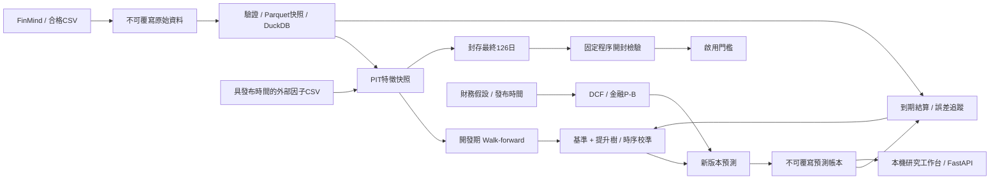

# 架構與可重現性

| 模組 | 介面與責任 |
|---|---|
| `data` | 嚴格行情契約、不可覆寫快照、檢查碼、DuckDB 查詢 |
| `ingestion` | FinMind 原始／還原資料對齊、HTTP 失敗與有限重試、CSV |
| `features` | `build_features`、`point_in_time_join`；只有 `f_` 欄位能進模型 |
| `research` | `ResearchConfig`、`run_research`、`train_latest`、`simulate_portfolio` |
| `holdout` | 固定資料時間界線之外的封存樣本評估 |
| `valuation` | 與短期預測獨立的財務假設及估值情境 |
| `ledger` | `append`、`settle`、`monitoring`；舊預測永不更改 |
| `workflows` | 固定快照與設定、封存協定、候選／正式模型、資料新鮮度與啟用門檻 |
| `cli` / `api` | 本機操作、查詢及受限制的固定任務路由，只綁定127.0.0.1 |
| `web_data` / `web_jobs` | 允許清單工作區讀取、單一背景任務及輸出遮罩 |
| `web_export` / `static` | 共用前端、僅含合成資料的靜態匯出，託管版停用執行 |

原始資料、模型 SHA256、程式摘要、特徵欄位、模型設定、決策時間與快照編號共同構成研究版本。不同程式或資料產生新版本，不覆蓋舊產物。相同輸入重跑預測會去重，重複預測內容改變則拒絕覆寫。

原始 FinMind 歷史行情時間以保守盤後時間重建，與系統實際看到資料的時間明確區分。這類重建不能自行通過正式 PIT 品質門檻。外部資料保留 `published_at`、`available_at` 和修正版本，依決策時實際可用的版本對齊。

帳本以同一新快照內的基準與到期還原價格計算實際報酬，避免資料商重新縮放歷史還原價格導致舊預測基準錯配。第一次到期結果及其快照留存；後續資料商修正需另做修正稽核，目前不自動覆寫答案。

本機 joblib 模型只載入專案自己產生的可信產物；介面不提供上傳或任意模型路徑執行。資料／模型環境建議分為 `artifacts/demo`、`artifacts/real`、`artifacts/preopen`。
