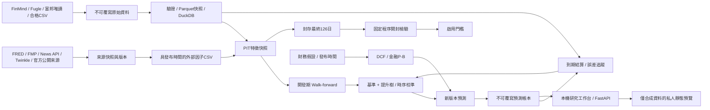

# 架構與可重現性

| 模組 | 介面與責任 |
|---|---|
| `data` | 嚴格行情契約、不可覆寫快照、檢查碼、DuckDB 查詢 |
| `ingestion` | FinMind 原始／還原資料對齊、HTTP 失敗與有限重試、CSV |
| `sources` / `public_sources` | 私人服務與TWSE／TAIFEX／TDCC／GDELT唯讀連接、日期及格式正規化、固定主機與覆蓋限制 |
| `source_store` / `source_workflows` / `source_verification` | 不可覆寫來源快照、事件／文件匯出、首次收件與修訂、逐端點格式及權限驗證 |
| `credentials` / `secret_audit` | 伺服端Key、PKCS#12私人複本、原生SDK日誌隔離、遮罩與發布集合稽核 |
| `universe` | 使用者固定十檔、延伸測試角色及指數點數語義 |
| `comparison` / `diagnostics` | 開發期特徵消融與以市場日期為單位的成對損失區塊抽樣 |
| `features` | `build_features`、`point_in_time_join`；只有 `f_` 欄位能進模型 |
| `research` | `ResearchConfig`、`run_research`、`train_latest`、`simulate_portfolio` |
| `holdout` | 固定資料時間界線之外的封存樣本評估 |
| `valuation` | 與短期預測獨立的財務假設及估值情境 |
| `ledger` | `append`、`settle`、`monitoring`；舊預測永不更改 |
| `workflows` | 固定快照與設定、封存協定、候選／正式模型、資料新鮮度與啟用門檻 |
| `cli` / `api` | 本機操作、查詢及受限制的固定任務路由，只綁定127.0.0.1 |
| `web_data` / `web_jobs` | 允許清單工作區讀取、單一背景任務及輸出遮罩 |
| `web_export` / `static` | 共用前端、僅含合成資料的靜態匯出，託管版停用執行 |

原始資料、模型 SHA256、程式摘要、特徵欄位、模型設定、決策時間與快照編號共同構成研究版本。不同程式或資料產生新版本，不覆蓋舊產物。相同輸入重跑預測會去重，重複預測內容改變則拒絕覆寫。

原始 FinMind 歷史行情時間以保守盤後時間重建，與系統實際看到資料的時間明確區分。這類重建不能自行通過正式 PIT 品質門檻。外部資料保留 `published_at`、`available_at` 和修正版本，依決策時實際可用的版本對齊。

帳本以同一新快照內的基準與到期還原價格計算實際報酬，避免資料商重新縮放歷史還原價格導致舊預測基準錯配。第一次到期結果及其快照留存；後續資料商修正需另做修正稽核，目前不自動覆寫答案。

本機 joblib 模型只載入專案自己產生的可信產物；介面不提供上傳或任意模型路徑執行。資料／模型環境建議分為 `artifacts/demo`、`artifacts/real`、`artifacts/preopen`。

固定十檔資料先分為訓練／校準／測試；0050、1216、2002、2412與TAIEX僅向同一凍結模型推論。十檔同儕因子不受外部資產影響，延伸評分亦不回流模型選擇，詳見[固定十檔協定](FIXED_TEN_PROTOCOL.md)。

## 方向研究擴充（2026-11-07）

`twquant.direction` 以獨立分類研究流程比較模型、訓練窗口與門檻，使用既有成熟標籤時間切分，將選模校準區間與外層測試分開。`audit_five_stock_accuracy` 在固定十檔共同日期上檢查逐檔與全部252種五檔組合；外部標的只用選出的同一模型推論。成果保存在獨立忽略目錄，不改動目前正式模型或帳本。

`direction-simulate` 另建立完全合成的資訊強度／延遲／缺漏情境；假設的潛在資訊不是已取得的供應商資料。流程、證據欄位與限制見[方向研究協定](DIRECTION_RESEARCH.md)。

`twquant.direction_models`將共用分類模型與市場／個股殘差報酬模型放在相同訓練介面後，回傳真正使用的訓練樣本以供稽核。分離模型的共同市場目標僅由完整的固定十檔訓練日期計算，缺少必要資料的候選保留原因碼。研究流程可比較原最低單檔準確率規則與固定門檻的兩種Brier規則；三種都不能讀取外層測試或延伸標的答案來選模。

`twquant.direction_audit`共用固定十檔與完整當期成分股的共同日期評分，並提供持股快照的中繼資料白名單。完整名單只擴大同模型外部推論與驗收，不改動十檔選擇過程；每個日期的成分股預測須使用同一模型版本和門檻。五檔平均的精確極值由逐檔共同分母的準確率排序求得，小宇宙仍保留完整枚舉作交叉檢查。

方向研究向`temporal_splits`提供只含固定十檔與0050的實際觀測交易日曆，按期間長度決定成熟終點，並移除對0050未來報價的相依。切分另外回傳完整測試日曆，使整個股票面板在折邊界缺漏時仍留在分母。一般報酬／投資組合研究的預設切分保留原本行為。

方向研究的`mode`必須與特徵矩陣的主要標的決策時間相符：盤後20:00或下一實際市場日盤前08:30。相同目標可使用不同資訊截止點，但兩種模式有各自的實驗與模型版本，避免混合不同時間契約。保留期凍結時間只由固定十檔與0050決定，外部股票的時間戳不參與訓練標籤可用性判斷。

`market`候選集以原十組為前綴，追加六種演算法的756日`portable_market`版本；新增版本排除宏觀事件與絕對美股價位。候選及輸入欄位在協定與逐折分數中留存，沿用同一擬合、校準與外層評分介面，不依外部股票結果選擇特徵或模型。

`overseas.add_overseas_window_features(frame, events)`是方向研究可選的特徵轉換模組。它重用`point_in_time_join`的可用時間及版本語義，在錨點20:00與實際決策時刻各取一次全球FMP收盤價，再輸出相對變動與新收件指標。模組不依賴個股歷史、答案或外部股票校準；原矩陣完整保留。CLI預設不呼叫，啟用狀態及實際新增欄位各自保存於來源紀錄與研究協定。

反應係數候選仍由`fit_direction_model`建立相同的共享因子／殘差模組。它在完整固定十檔訓練日期，將成熟答案投影到當時已知的`f_beta_60`，再擬合共享殘差；推論時依各股已知係數還原共同因子的影響。可選波動分數的缺失替代值及尺度只由實際訓練列估計，外部批次不重新擬合。原分類器與平均市場因子路徑保留。
