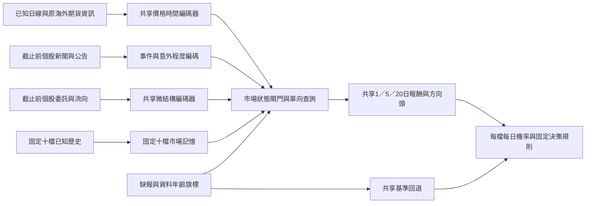

# 每日完整預測75%的設計可行性

2026-11-12依更新後的目標，這份工作評估架構與資訊需求，**不等待所有資料取得或未來實績**。保留每天完整預測、任意五檔、弱股及未知答案的要求。既有歷史實驗沒有被重新標為成功，正式模型與實績門檻也不變。

**判斷：值得研究的候選是「市場狀態引導的共享多模態模型」，但目前證據不足以無條件預期每日任意五檔達75%。** 下面給出一個條件期望77.63%的設計情境，以及會使它失敗的具體條件。77.63%來自明確假設的資訊強度，並非從GitHub成績移植、資料推估或已訓練模型得到的預測。

## 1. GitHub及原始研究核對

以下是截至本次檢閱可借用的設計；未安裝、執行或下載外部模型權重。

| 方案及一手來源 | 真正任務／證據 | 本系統可借用的設計 | 對75%目標的限制 |
|---|---|---|---|
| [MASTER官方程式](https://github.com/SJTU-DMTai/MASTER)、[原論文](https://arxiv.org/html/2312.15235v1) | 市場引導特徵選擇、跨時與跨股注意力；主指標為IC、RankIC及選股組合績效 | 市場狀態閘門、小型時間編碼器及固定十檔記憶 | 排序相關與組合報酬不是每日絕對漲跌準確率。官方另揭露公開驗證／測試資料曾誤用訓練處理器，不能直接沿用資料及缺值刪除流程 |
| [StockMixer官方程式](https://github.com/SJTU-DMTai/StockMixer)、[評估程式](https://github.com/SJTU-DMTai/StockMixer/blob/master/src/evaluator.py) | 指標、時間與股票混合；評估包含IC及最高排名組合 | 較小的MLP時間／指標混合，作為Transformer的成本對照 | 股票維度混合須改為固定十檔記憶加單向查詢，不能讓外部50檔互相供應同儕資訊；現有指標沒有證明全覆蓋75% |
| [DeepLOB官方程式](https://github.com/zcakhaa/DeepLOB-Deep-Convolutional-Neural-Networks-for-Limit-Order-Books)、[論文表II／IV](https://arxiv.org/html/1808.03668v6) | FI-2010設定二、10事件期準確率84.47%；LSE轉移測試20事件期68.62%，是含不變類的短事件期價格方向 | 共享的委託簿時空編碼器、未見股票轉移的設計方式 | 事件數不是交易日，三類中間價不是前收盤至未來收盤方向；盤前08:30不能用後續委託或最終開盤價 |
| [FinGPT Forecaster官方說明](https://github.com/AI4Finance-Foundation/FinGPT/tree/master/fingpt/FinGPT_Forecaster) | 過去數週新聞及基本面，預測下一週；已發布模型以DOW30資料微調 | 新聞事件整理、正反訊息及結構化欄位；不直接採用其市場預測權重 | 週預測不同於每日全覆蓋；預訓練／微調股票及時間未符合本專案固定十檔契約，不能拿展示回答當方向證據 |
| [Kronos官方程式](https://github.com/shiyu-coder/Kronos)、[原論文](https://arxiv.org/html/2508.02739v1) | 多市場K線預訓練、機率路徑生成；報酬主要以IC／RankIC評估 | 機率報酬頭及多路徑不確定性；小型固定十檔版本可另設計 | 生成多條路徑不能創造資訊。發布權重的市場預訓練範圍不符合固定十檔限定，不能直接採用來證明轉移能力 |
| [Qlib](https://github.com/microsoft/qlib) | 量化研究、資料處理及多種模型的框架 | 可重現處理器、時序流程與模型比較 | 框架本身沒有提供本目標75%的證據；仍須保留原錨點、完整日期及未知答案 |
| [StockNet原論文](https://aclanthology.org/P18-1183.pdf)、[官方資料庫](https://github.com/yumoxu/stocknet-dataset) | 結合文字及價格；報告58.23% | 文字與價格聯合建模、交易日對齊 | 原資料刪除38.72%的小幅漲跌，另要求視窗有推文；連其58.23%也不能直接當本系統全覆蓋基準 |
| [2023新聞嵌入與label smoothing論文](https://arxiv.org/pdf/2301.10458)、[其引用的資料程式庫](https://github.com/WenchenLi/news-title-stock-prediction-pytorch) | 主分類結果80.7%，另有以前日資訊預測的76.5%結果 | 正則化及文字編碼作候選消融 | 主任務包含當日新聞且未證明價格／新聞先後；資料刪除模糊方向，並以shuffle=True隨機分割重疊視窗。附加預測結果仍不證明時序獨立、完整覆蓋及未見股票條件 |
| [2026情緒研究原文](https://arxiv.org/html/2602.00086v3)、[官方程式](https://github.com/Walids35/capstone-stock-prediction) | 表1約75–79%是新聞情緒分類；下游股價方向分開評估，正文LSTM準確率57.47% | 多文字編碼器的互補性及結構化每日聚合 | 情緒分類準確率不可當成漲跌準確率；表3報告F1／AUC也不可換算為本目標75% |

上表只保留可核對的指標及適用性；沒有將其他市場、新聞分類、排名、交易獲利或刪除難樣本後的成績換成本系統預期準確率。已完成的[Trader Skills評估](SKILL_INTEGRATION_EVALUATION.md)亦保留，其篩選與風控不會增加每天必答的方向資訊。

## 2. 建議架構：共享多模態與固定十檔記憶



- **價格頭**：60個已知市場日的小型時間編碼器，先比較MLP／小型Transformer，避免以大模型規模當成資訊增益。市場閘門讀固定十檔共同狀態及截止前海外資訊；原可用特徵及線性／樹基準保留。
- **文字頭**：將截止前自己的新聞／公告整理為實體、事件、數值意外、來源、首次收件、修訂及年齡。可用凍結的通用文字編碼器提取內容；市場預測頭只用固定十檔訓練。前瞻使用須先凍結編碼器；新語言模型不能拿來證明其訓練日期之前的歷史PIT。
- **微結構頭**：只接實際截止前自己的委託／試撮／流向，參考DeepLOB的共享編碼概念；不存在的歷史資料以缺報旗標處理。08:30決策不接受08:30以後的試撮、成交或最終開盤價。本設計沒有把第十三、十四輪的合成開盤參考變成真實輸入。
- **轉移方式**：固定十檔是唯一訓練、校準、選模及記憶來源。外部股票僅以自己的已知輸入向固定十檔記憶查詢，不能更新記憶，也不能互相注意或回傳給核心。全部50檔及0050／1216／2002／2412／IX0001使用同一共享參數、校準器及決策規則；指數不交易。
- **訓練頭**：直接學絕對漲跌BCE與報酬分布，不能以橫斷面排名標籤取代目標。可比較固定十檔平均與最弱股損失的組合；所有權重、補值、尺度與超參數只由成熟訓練／校準期決定。三個期間各自評估，不能把一日估算宣稱為五日或二十日結果。
- **每日輸出**：缺新聞、委託簿或模型低信心時仍輸出共享基準機率；不篩股票、不排除平盤、不靠只預測強訊號日達標。答案未知繼續算在完整日期分母。新的模態先作獨立資料契約與消融，不直接改正式預測。

這是可實作的候選設計，不是已接上所有模態的後端。現階段已實作的是下一節的離線可行性估算器；尚未實作上述神經網路、取得全部新聞／委託資料或宣稱它們具有所假設的資訊量。

## 3. 不等資料齊全的定量評估

新增`direction-feasibility`。它不讀行情、憑證或保留期，不訓練任何股票模型；對50個抽象成分逐一計算期望，最弱五檔平均即覆蓋全部2,118,760種五檔組合。較弱的五檔不能被其餘45檔平均掩蓋。

假設零均值常態報酬由已知條件平均與獨立未來創新組成。若已知資訊可解釋總變異比例`R²`，方向符號相同的機率是：

`p(R²) = 1/2 + asin(sqrt(R²))/π`。

推導來自兩個獨立常態量的均勻極角；相關為`ρ=sqrt(R²)`時，符號不同的角度占`acos(ρ)/π`。所以在這個模型內75%對應`R²=0.5`。**這不是所有市場或所有報酬分布的必要定律，亦不是本地測得的R²。** 漂移、厚尾、制度變動、不可學得的訊號及錯誤校準均可能使此簡化不適用。

新增訊號可得率為`q`、缺訊號時基準準確率為`p₀`、新訊號可用時為`p₁`、未知答案比例為`u`，完整分母的期望為：

`A = (1-u) × [q × p₁ + (1-q) × p₀]`。

所有日期仍預測，`q`是資料可得率，**不是預測覆蓋率**。模擬先產生當時可見分數及缺報，再抽獨立未來創新；並未從未來收盤反推一個貌似可得的供應商欄位。已知真條件平均只是樂觀資訊基準，不能證明實際模型能學會它。

### 已凍結及執行的五情境

[設定檔](../configs/direction_feasibility.json)使用50個抽象成分、一日目標、每檔20,000次合成決策抽樣及17／29／43三個種子，全部保留。以下都是**假設下的數學期望**，不是市場準確率預測。

| 情境 | 主要假設 | 50檔平均期望 | 最弱五檔期望 | 條件式75% |
|---|---|---:|---:|---|
| 價格資訊示例 | `R²=.08`、未知答案`.1%` | 59.07% | 59.07% | 未通過 |
| 稀疏新聞 | 基準`R²=.01`、增強`.65`，只有20%日期可得 | 58.46% | 58.46% | 未通過 |
| 多模態設計條件 | 每檔基準`.01`、總資訊`.60`、98%可得、`.1%`未知 | 77.63% | 77.63% | 僅在假設成立時通過 |
| 轉移弱股壓力 | 只有五檔的總資訊降至`.25`，其餘仍`.60` | 76.50% | 66.33% | 未通過 |
| 來源失效壓力 | 總資訊`.60`，可得率降至75%、1%未知答案 | 71.23% | 71.23% | 未通過 |

多模態情境的三個種子，抽樣最弱五檔分別為77.079%、77.172%、77.143%，沒有挑選最好種子。有限抽樣後選最弱五檔會低於相同分布的母體期望；這些差異不構成真實未來績效的信賴區間。

以多模態情境的弱基準`p₀=53.1884%`、98%可得及`.1%`未知答案反推，可用日期至少要達**75.5217%**，對應常態模型內總資訊`R²≈51.6388%`。設定的60%是尚未證實的強假設，不是論文或現有資料推得的中央估值。若只有20%日期取得新增訊號，即使該訊號完美，也不夠達到完整每日75%；這說明只增加少量事件日新聞不能補足本目標。

### 集成模型的相關錯誤

另用[SciPy的beta-binomial分布](https://docs.scipy.org/doc/scipy/reference/generated/scipy.stats.betabinom.html)作可交換伯努利正確事件的敏感度分析：15個各60%的模型，若完全獨立，多數決期望78.69%；錯誤相關為`.02`時75.85%，`.05`時72.82%，`.15`時67.30%。它是特定聯合分布的假設，不能只知道一個相關係數就對任意模型作此預言。

獨立核對前輪三個政策的原證據雜湊後，在原301日資訊就緒範圍、完整50檔及未知答案算錯的共同分母，實際錯誤兩兩相關約`.275`、`.630`、`.640`。這只是既有三個異質政策的描述，不是15個模型的估計；但它不足以支持「多加同類模型即可當成獨立投票」的設計假設。此診斷沒有重訓、校準、選模或改動原結果。

## 4. 資料與工程可行性

| 設計需求 | 目前狀況 | 尚待成立的條件 |
|---|---|---|
| 日線／海外／期貨／法人／融資融券基準 | 已有連接器及獨立歷史研究；最新還原價與重建收件仍有界線 | 原始發布版本、到件延遲及單位契約；不能把當前下載當歷史交付 |
| 截止前自己的新聞事件 | 部分公告及新聞中繼資料已取得 | 公司映射、完整文本使用權、首次到件／修訂、事件與意外程度，且在非事件日仍有共享基準 |
| 截止前自己的委託／試撮 | 尚無足夠本目標歷史或交付驗證 | 實際08:30以前的可用範圍；逐筆或較晚盤前資料不自動等於該截止可得 |
| 共享模型與轉移 | 固定十檔流程及同模型測試已有；新多模態網路待實作 | 固定十檔記憶、單向外部查詢、小型編碼器、共同校準與缺報回退 |
| 預期75%的依據 | 有條件式反推及可重現模擬 | 尚無證據支持每檔至少約51.64%的日報酬資訊、98%可得率及足夠跨股可轉移性 |

設計採模組化的訊號輸入、共享推論及獨立評估；可先實作價格／市場閘門的小型版本，再按契約加入新模態。新聞與委託資料不必齊全才能完成這份評估，也不因此自動購買資料、啟動排程或交易。現有基準及第十三輪理想化開盤情境都未達標，不能把「開盤資訊有增益」當成足以支持75%的證明。

## 5. 執行與解讀

```bash
LOKY_MAX_CPU_COUNT=1 .venv/bin/python -m twquant direction-feasibility --config configs/direction_feasibility.json --out artifacts/direction-feasibility/design-v1
```

輸出目錄必須不存在；保存`protocol.json`的設定／程式摘要及`report.json`全部情境與種子，不覆寫。`expected_target_met_under_assumptions=true`只表示該組假設算得通。`empirical_target_met`、`real_world_target_verified`與`unconditional_75_expectation_supported`一律保持`false`，不能用此命令推進正式模型或實績狀態。

目前可以完成架構選擇、資訊需求反推及壓力估算；無需等全部資料就能判斷，**單靠既有價格變體或高相關集成，不足以合理支持75%的預期**。多模態共享設計提供有條件的達標路徑，但最關鍵假設尚未獲得一手研究或本系統證據支持，因此它仍是研究目標，不能寫成已具可信中央估計的75%方案。

## 6. 補充來源與可執行的相似狀態方案

本輪補查以下一手研究，保留相同的日線、完整預測與固定十檔條件。

| 來源 | 核對結果 | 設計判斷 |
|---|---|---|
| [臺灣Radius Neighbors研究](https://www.mdpi.com/2504-2289/10/4/109) | 報告最佳85.1%，使用60日視窗、20日TAIEX市場強度，且移除缺值；正文的QFII相關也不能直接當成前瞻個股相關 | 值得測試歷史相似狀態的思路；不移植其85.1%、資料刪除、指數目標或無法獨立核實的預處理／切分細節 |
| [FusionLSTM-CNF原文](https://www.nature.com/articles/s41598-026-43381-3) | S&P500設定全樣本61.2%；71.2%是只取最高40%信心的交易，另有59.8%的延伸期結果 | 可參考模態權重及缺報降級；篩信心後的成績不能代替本目標每天必答，亦無法直接支持75% |
| [CRAFT原文](https://pmc.ncbi.nlm.nih.gov/articles/PMC13649149/)、[官方程式](https://github.com/snudatalab/CRAFT) | 日收盤漲跌ACC約0.50–0.56；投資模擬另採機率閘門，兩者為不同結果 | 可研究訓練期分群與雜訊處理；跨股聚合須改為固定十檔記憶，不能將外部股票當共同輸入，也不能把Sharpe改善當75%方向準確率 |

依第一項的局部歷史匹配思路，已另實作`direction-search --candidate-set similarity`。它是本專案的共享二元機率分類器，**不是原論文市場強度回歸模型的重現**；使用現有已知特徵與原始收盤方向目標，沒有取得新供應商資料、製造未來訊號或等待新聞／委託資料齊全。

七個候選為四個明確控制（prior、756日價格logistic、756日`portable_response`的logistic／hist），加上三個756日共享近鄰候選。近鄰先以成熟固定十檔訓練資料擬合中位數補值、缺報指標及標準化，採轉換後每維均方根歐氏距離，半徑固定為0.5／1／2。名義上保留最近256筆，截點等距者全部納入，避免任意截斷標籤；至少需要20筆、五個不同歷史日期，並以十筆訓練先驗偽觀察收縮機率。相關近鄰不是獨立證據，這個機率也不冒稱已校準信心。

找不到足夠匹配、缺乏已知輸入或歷史不足時，仍輸出訓練期共享先驗。外部股票不能新增近鄰或改動轉換器，自己的未來答案也不參與查詢。三規則、1／5／20日、完整50檔、全部日期與126日保留期維持原樣；另以原四控制建立相同資料與時序的對照。這是獨立七候選研究，不能說成原54組再加三組；與先前54候選的分數比較僅作背景，匹配四控制才用於檢查新增方法的影響。

第一版的等距截斷問題已用合成反例重現並修正，原結果及程式快照保留於忽略目錄；修正後以新協定／程式摘要重跑，未改資料、半徑或收縮參數。沒有將較有利版本挑成未揭露的唯一結果。

六組比較與獨立核對已完成，四控制的校準分數與既有相同候選完全一致；部分平均改善沒有轉成穩健弱股優勢，所有範圍及期間仍未達75%。等距修正前後的歷史機率與校準分數逐項相同，合成反例修正不被當作市場績效提升。此結果支持保留相似狀態作研究候選，但不足以把可行性評估提高為可信的75%預期；仍不必等待全部新模態資料才能作出這個判斷。

## 7. 盤中範圍擴充

使用者於2026-11-12另同意較短的盤中未來區間，仍維持每天完整預測及任意五檔。新增[盤中方向設計與一手來源核對](INTRADAY_DIRECTION_DESIGN.md)，分開固定秒數的原始端點方向、事件數與平滑三類標籤，並提供完整50檔的離線稽核介面。該介面是驗收工具，序列模型仍屬設計候選；來源與條件反推尚不足以支持無條件75%預期，不會將盤中基準成績套回日線目標。

[有限期間隊列研究](QUEUE_SIMULATION.md)已完成60組、240個控制稽核：固定十檔實際學習後，30秒持續壓力合成情境的最弱五檔93.90%～94.06%，但只減弱五個外部標的壓力即降為45.90%～47.26%。這提供可學習的條件式模擬路徑，並非給分類器直接指定正確率；強度與出現頻率尚無市場依據，故不能據高分建立臺灣任意五檔的可信75%預期。

[混合窗口與流動性補償研究](QUEUE_MIXTURE.md)進一步完成36組及180個控制稽核。強窗口機率70%、其餘為弱窗口的合成情境，最弱五檔為77.60%～78.58%；但其條件多重比較下界尚未通過。輸入缺報、較弱外部股票及流動性補償仍可能使結果失效。固定參考的全50檔條件點需求約為61.71%～63.23%強窗口，25%缺報則為80.56%～81.73%；這些不是市場頻率估計，仍不足以建立合理市場75%預期。

[混合流動性共享模型研究](HETEROGENEOUS_QUEUE.md)另完成18組、108個模型稽核。同一實驗內的固定十檔共享權重可處理多種流動性係數；較有利混合環境的最弱五檔為86.26%～86.88%，但外部五檔機率改變後降至64.22%～66.04%，外部僅見訓練未見環境時為59.84%～60.12%。新增相對深度／交互特徵對原hist沒有穩定增益；全部8組樣本過關、3組人工抽樣條件下界過關，仍不能建立合理市場75%預期。

[完整狀態資訊上限診斷](QUEUE_CEILING.md)完成15組、60個期間面板與300萬列條件計數。即使知道隱藏壓力及完整人工生成規則，強補償過程的最弱五檔30秒上界僅59.51%～59.75%；前輪外部未見環境的加權30秒上界為72.04%～72.44%。這些人工過程內的缺口不能靠更換分類器消除；其他較高上界亦不證明可部署75%方法。1秒上漲／非上漲的高基準主要來自平盤，與目前嚴格方向目標分開呈現。
