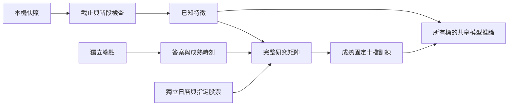

# 本機委託簿到因果研究矩陣

`twquant.intraday_book_frame.build_intraday_book_frame`把本機標準化快照與獨立端點資料，轉成固定時刻、全部指定股票的研究矩陣。這補上合成過程與未來資料驗證之間的接口；沒有連線供應商、讀取憑證、建立訂閱或啟動行情排程。



## 輸入與時鐘

`quotes`需有`ticker`、`state_at`、`received_at`、`bid_prices`、`ask_prices`、`bid_sizes`、`ask_sizes`、`is_trial`、`is_continuous`及`source`。四個價格／數量陣列皆須五項；已知空深度可明確給零數量，不能把未知掛單補成零。正數量的價格必須有效且依深度排序，最佳兩側均需有量且不能交叉；最佳價格0不能當普通限價。

[Fugle官方Books說明](https://developer.fugle.tw/docs/data/websocket-api/market-data-channels/books/)提供五檔陣列與階段資訊，並說明空深度、0價格等特殊情況。該原始回應不直接等於此接口：還需另存本機到件、確認訊息／完整快照語意及來源。供應商更新時間不能改名冒充本機到件。

`expected_decisions`必須來自獨立主要交易日曆，含明確時區、每天同一時刻。支援固定1／5／30／60秒端點；決策與端點保持正常連續交易時間內。每次特徵截止為決策前一秒，保留一秒計算緩衝。

先只選擇截止前已收到、同一臺北日期且狀態時間不晚於截止的快照。再按狀態與當時可見的到件版本排序，對截止前100個一秒時間點作向後as-of取樣，每個快照最多沿用兩秒。只向後沿用，不做雙向插值；當時尚未收到的晚到修正、下一日或其他股票資料都不參與。

抽到試撮、階段不明、錯誤價格、到件早於狀態的時序違規或過舊快照，則該股票／日期的`input_ready=false`，特徵保持未知。矩陣仍保留這一列，不用前一個較有利快照藏掉問題。`input_reason`解釋缺歷史、過舊、無效快照或指數無委託簿。

## 端點獨立於特徵

`checkpoints`需有`ticker`、`price_at`、`available_at`、`bid`、`ask`、`index_value`、`is_trial`、`is_continuous`及`source`。它是來源已確認的**精確決策／端點狀態**，不是把最後一筆舊行情任意向後貼標。

股票／ETF只用有效兩側報價中價；指數只用正的`index_value`，不製造委託簿或用ETF替代。相同股票／時點有兩個版本時會拒絕輸入，需先明確釘選來源版本。到件不得早於狀態時間。

身份或時間欄位缺漏、無時區屬於輸入格式錯誤，會拒絕整批資料。無法提供的端點應省略該checkpoint列；函式仍會在完整股票／日期網格保留未知答案，而非刪除該預測日期。

決策與端點任何一個缺失或階段不符，`actual_return`與`label_available_at`保持未知，仍占完整稽核分母。標籤可得時間取兩個端點到件較晚者，讓既有成熟標籤檢查可以拒絕尚不可知的訓練答案。

端點表完全不參與特徵；改變未來價格或較晚到達的歷史修正，都不會改變截止前的輸入。

## 可跨單位的特徵

`portable_book_v1`使用各深度累積不平衡、相對總深度、5／20／100秒的不平衡均值與變動，以及過去中價變動／波動。價格歷史以最後已知價差作機械尺度，深度以當時總可見數量取比例；沒有對外部股票擬合補值器、校準器或標準化器。

因此同一報價只改價格單位或數量單位時，特徵保持相同；不使用合成過程中依賴抽象量單位的`f_book_log_depth_*`。這是**新的特徵契約**，需以同契約的固定十檔資料重新擬合，不能直接套用原合成歷史模型的不同欄位權重。

```python
from twquant.intraday_book_frame import build_intraday_book_frame

frame = build_intraday_book_frame(
    quotes, checkpoints, declared_tickers,
    expected_decisions=verified_primary_calendar_at_1000,
    horizon_seconds=30,
)
```

輸出可交給`fit_intraday_model`，仍只允許固定十檔成熟資料訓練；所有成分股共用同一模型與門檻。指數保留自身端點答案，但沒有委託簿特徵，推論只能回退共享先驗。

缺輸入時仍可發先驗預測；發報資料的可得上界需包含已知模型／選模時間，不能把缺到件時刻填成剛好決策前一瞬。此接口不替呼叫者製造這項資訊。

## 證據狀態

來源含合成標記時，列標記為`evidence_kind=synthetic`；其他輸入最多為`unknown`。供應商名稱、手填的`historical`或`quote_provenance_verified=true`不能升級可信度。該欄位不是舊日線價格分類器的輸入，此矩陣也不是可直接寫入日線PriceStore的OHLC資料。

`prediction_at`是研究計畫時刻，`emission_clock_basis=planned_research_cutoff`，不能當作已觀測到的不可改寫發報紀錄；`quote_provenance_verified=false`始終保留。實際接收器、連線連續性、資料權限與發報延遲仍需單獨驗證。

本輪以合成報價測試單位不變性、遲到／未來資料隔離、缺答完整網格、外部資料隔離、指數無委託簿，以及固定十檔訓練後同模型推論50檔。這是資料流程驗證，沒有新增真實市場準確率，也不改75%研究驗收。
