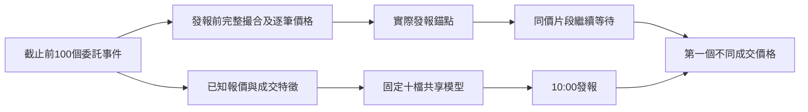

# 逐價成交與精簡推論的75%設計評估

本研究延續使用者已接受的成交價目標：每天10:00對全部50檔發出向上或向下預測，評分發報後60秒內第一個不同成交價。同價成交繼續等待，逾時與未知答案均留在分母。中間價及日收盤目標分別驗收。

固定十檔是唯一訓練、補值、校準與選模來源。0050、1216、2002、2412沿用同一共享模型查詢；IX0001保留共享先驗查詢及未知的成交價答案，指數不建立交易委託簿。

本輪把**固定價差反彈策略**事先指定為精簡推論的設計候選。共享logistic與hist仍完整比較，只有反彈策略使用本輪量測的陣列介面。不能把其他模型較高的研究分數套用到反彈策略的計算延遲。

## 撮合機制

[證交所營業細則第58-3條](https://twse-regulation.twse.com.tw/tw/law/DOC01_print.aspx?FLCODE=FL007304&FLNO=58-3)規定，逐筆輸入的申報依既有對手方價格，由較好價位逐次成交。[第58條](https://twse-regulation.twse.com.tw/tw/law/DOC01_print.aspx?FLCODE=FL007304&FLNO=58)另列出當日有效、IOC及FOK等有效期別。本輪實作價格層級的市場移除、限價留單／IOC及撤量；同價位內的個別委託ID、FOK、價格穩定措施及完整交易所規則仍不由此模型重建。

[ABIDES原始OrderBook](https://github.com/abides-sim/abides/blob/master/util/OrderBook.py)可參考部分成交與逐價消耗機制。其`LAST_TRADE`是一次委託的平均成交價；本輪另保留各價位執行片段的價格、數量與順序，發報錨點使用最後一個片段，答案使用發報後第一個不同價格片段。程式為本專案自行實作，沒有匯入ABIDES資料或權重。

例如賣方100元有2單位、101元有3單位，買進4單位依序成交100元2單位、101元2單位，留下101元1單位。買方報價維持原狀；最後成交價為101元。若限價100元買進5單位，只先成交100元2單位，餘3單位依留單或IOC設定處理。



買單逐價消耗賣方，賣單逐價消耗買方。只有該側價量被移除、撤除或新增，才改變該側報價；最佳價差可大於一跳。沒有最佳隊列耗盡後同時重設雙方報價或補單的規則。

初始已知價格帶有128個抽象跳動價位，每價位5至10單位。價位亂數固定在共同1024格座標上，擴大尚未碰到的已知深度不改當前觀測或路徑。已知價格帶耗盡、委託超出已知範圍，或運算預算不足，都保留未知；不補出虛構報價，也不轉成已確認逾時。主要訓練／校準若出現未知，研究停止並保留協定。

## 可觀測輸入與時間

歷史窗口是過去5／20／100個委託事件。模型只用當時的不平衡、相對深度、歷史中間價摘要及最後成交價相對中間價的位置。新增三個明確允許的特徵：價差跳數、最佳買深度／過去平均成交片段量、最佳賣深度／過去平均成交片段量。量的正規化只讀過去100事件，平均片段量以一單位為下限；部分特徵缺失不能靜默換成另一種輪廓。

隱藏壓力、未來錨點、答案、事件率宣告及任何額外oracle欄位都不供預測器使用。外部股票只提供自己的觀測查詢，不進入主要訓練或同儕脈絡。

獨立的第17個亂數座標產生指數事件等待時間，其餘16個座標決定委託。從輸入截止到發報的事件全部繼續演化，發報前跨多價成交後以最後一個價格更新錨點；發報後若先同價成交，再跨下一價位，答案取第一個不同價位及該片段序號。

`actual_return`在本輪記錄真實抽象跳動價格差除以發報錨點；較早簡化研究的一單位方向碼各自保留。價格是合成跳動座標，沒有當作真實臺幣價格或獲利。

## 事先固定的研究

`configs/matching_first_change.json`固定600訓練、200校準、2000測試日期、三種子及四候選，共36組及144個候選稽核。十二情境在主要研究擬合前固定：

|情境|宣告的人工條件|
|---|---|
|一般逐價、零延遲|每秒100事件；65%激進單、15%撤量、20%被動限價|
|100微秒／1／5毫秒|同一過程，完整處理發報前事件|
|最佳價IOC|激進單只限當下最佳對手價，剩餘取消|
|較大逐價單|10%激進單改為16或32單位|
|限價較多|15%激進單、35%撤量、50%被動限價|
|限價較多且有大單|上述比例，另10%激進單為大單|
|外部五檔較快|只有1216、2303、2327、2345、2357改為每秒1000事件|
|外部五檔較大單|只有上述五檔增加大單比例|
|25%共同缺報|仍每天回答，使用固定十檔先驗回退|
|極慢事件|每秒0.01事件，逾時仍計錯|

普通單量1至4單位的比例為60%／20%／10%／10%；被動限價在有價差空間時可改善報價，其餘掛在同側附近價位。委託種類、數量、深度、到達率及固定鐘點分布都是未校準假設，沒有從文獻的單筆量比例推定為現今臺灣全部50檔的參數。

全部日期為明示的合成平日，並非交易所歷史。每組依固定十檔校準期最低單檔、平均及固定候選順序選模，完整保留所有候選測試結果；事先指定的反彈策略另外獨立報告。

```bash
LOKY_MAX_CPU_COUNT=1 .venv/bin/python -m twquant direction-matching-study --config configs/matching_first_change.json --membership artifacts/current-membership/20261107/membership.json --out artifacts/matching-first-new-run
```

## 研究結果

完整36組及144個候選稽核已獨立核對。每組保留50檔各2000日期與三個額外轉移查詢；表中為三種子的範圍，全部股票、種子與失敗情境均保留：

|情境|校準所選模型最弱五檔|固定反彈最弱五檔|固定反彈最低單檔|
|---|---:|---:|---:|
|一般逐價、零延遲|76.65%～77.47%|76.85%～77.51%|75.85%～77.30%|
|100微秒|76.52%～77.24%|76.72%～77.22%|75.55%～77.10%|
|1毫秒|75.34%～75.95%|75.48%～75.87%|74.30%～75.15%|
|5毫秒|69.70%～69.82%|69.70%～69.89%|68.45%～69.50%|
|最佳價IOC|75.17%～75.86%|75.60%～76.15%|74.60%～75.90%|
|較大逐價單|75.64%～76.06%|75.52%～76.06%|74.90%～75.15%|
|限價較多|82.24%～82.73%|82.24%～82.69%|81.40%～82.25%|
|限價較多且有大單|78.43%～79.84%|79.29%～79.91%|78.55%～79.30%|
|外部五檔較快|76.32%～77.14%|76.54%～77.21%|75.55%～77.10%|
|外部五檔較大單|76.20%～77.17%|76.56%～77.22%|75.55%～77.10%|
|25%共同缺報|69.10%～69.86%|69.06%～69.80%|68.25%～69.45%|
|極慢事件|15.95%～17.63%|17.43%～17.87%|16.70%～17.65%|

所選模型23／36組、固定反彈22／36組通過完整樣本門檻，另要求最低單檔75%及逐股方向基準優勢。最弱五檔平均與最低單檔分開列出，沒有用較好的平均掩蓋弱股。

在兩政策×50檔×36組的共同單側Clopper–Pearson抽樣家族中，所選模型4組、固定反彈5組的最低單檔下界達75%。固定反彈在一般100微秒情境的下界只有71.350%～72.981%；限價較多情境為77.544%～78.454%，加入較大單後為74.512%～75.307%。這些界限描述宣告人工過程中的抽樣誤差，沒有把未知市場規則或參數誤差納入。

全36組的成分股答案都在預算內解決；極慢情境保留約75.30%～75.39%逾時。獨立參考的更不利路徑另包含6條深度不足的未知答案，未被當成逾時。主要情境沒有因為未知或弱股票被靜默刪除。

一般事件比例的觀測價差中位數為9跳，約89.3%的列超過一跳；限價較多情境的中位數為1跳，約13.7%～13.9%的列超過一跳。價差分布顯著依賴委託比例，不能把兩組的較高分直接當作臺灣市場中央估計。一般情境約6.4%～6.6%的變價答案出現在同一委託的第二個或之後成交片段，凸顯保留執行順序的重要性。

因此，固定共享反彈策略在合法逐價消耗與獨立報價更新的人工過程中，仍有超過75%的條件式路徑；計算側亦已有可執行的精簡介面。但合理市場75%預期仍取決於實際固定時點的價差／單量／委託組成、完整輸入可得率及發報新鮮度。下一步應核對這些條件及較可取得的延遲範圍，保留原先完整覆蓋標準。

數值協定、來源快照與核對資料保留於本地`artifacts/matching-first-20261113-v1`。核對包括1400筆獨立字典委託、96條獨立過去／未來路徑、全部四候選只用固定十檔重新擬合，以及全部53標的機率與完整日曆分母。外部活動／單量干預不改主要訓練、校準或其餘標的；延遲變化不改已觀測特徵。

## 精簡推論

`TradeFirstModel.predict_locations`接受已準備的最後成交位置與布林可用狀態，沿用相同固定十檔先驗、十二位小數規則及共享版本。它拒絕非數值位置、形狀不符、非布林可用狀態及可用列的非有限值，並保留缺報與指數查詢的先驗回答。

全部36組舊成交價研究重新只用固定十檔擬合反彈候選；381.6萬筆查詢的原DataFrame機率、陣列機率與保存輸出逐筆相同。這項加速沒有改變已驗證的方向規則。

50檔單日輸入暖機後，1000次成對計時如下，單位為微秒：

|介面|中位數|95百分位|99百分位|本次最大值|
|---|---:|---:|---:|---:|
|DataFrame|3579.813|3885.344|4151.041|8377.958|
|預備陣列|11.833|14.586|17.593|78.250|

陣列準備在計時之外。這些只量到預測計算，未包含行情傳輸、解析、特徵維護、時鐘誤差、排程、發報與保存；不能據此宣告整條路徑已達100微秒。

## 設計條件與接入

精簡路徑需要在行情事件到達時持續維護最後成交價、有效買賣報價、可用狀態與來源時鐘，讓固定時間的預測讀取已準備狀態。預測發布需保存實際時間、輸入水位與模型版本；來源缺口、晚到或未知答案仍按完整分母計分。

100微秒情境是輸入截止至發報的整體條件，包含計算與尚未量測的其他部分。正式設計須取得完整事件來源及可核對的序列／缺口規則，並對收件、時鐘與發報耗時作預算。較慢快照、單一流水號或供應商模式名稱都不能直接當作通過此契約。

[證交所主機共置說明](https://www.twse.com.tw/en/products/colo/qa.html)提供可能的直接行情接入架構與申請資格；它沒有本專案的100微秒新鮮度保證。這裡評估接入條件，沒有申請、購買、連線或啟動真實排程。

模擬能檢查方法、時間與失效條件，尚不能替未知的委託比例、日間狀態、掃單分布、停牌／價格穩定措施與實際行情契約提供市場校準。條件抽樣信賴界限也不涵蓋這些模型差異。所有成功與失敗情境均保留，不會用高分子集合替代每日任意五檔要求。

[毫秒延遲評估](OPERATIONAL_FIRST_CHANGE.md)沿用相同來源與固定反彈介面，以新種子另檢查限價較多時的1／5／20毫秒、大單、外部高活動與共同缺報；其分數及公開證據的適用範圍分開報告。

## 可設定的初始深度

`MatchingScenario.initial_depth_range`接受兩個整數，範圍為`1 <= low <= high <= 1000000`，控制過去100事件之前各價位的初始量。預設仍為`[5,10]`，使用原本的1024格亂數座標；擴大未碰到的已知價格帶不改共同價位的初始量。

`external_depth_ranges`可為外部成分股指定自己的範圍，例如`[["1216",[1,2]]]`。它拒絕主要訓練股票、指數、重複標的與非法範圍；研究入口另拒絕成分股快照之外的干預。外部深度只影響該股票自己的書簿，不改主要擬合、校準或其他查詢。

範圍只改初始條件。其後仍由逐價成交、撤量及掛單演化，沒有把發報時的最佳深度固定在範圍內，亦不補回已耗盡的量。分類器只讀取當時可觀測的深度與歷史特徵，沒有收到宣告範圍作為隱藏輸入。

這項介面在[方向持續研究](PERSISTENT_FIRST_CHANGE.md)完成之後加入，用於後續薄／厚深度與外部弱股的明示壓力研究；本輪沒有依較厚範圍宣告新的75%成績。預設行為另以變更前4500列完整歷史／答案／時間比對、初始式在預設值下的語法樹等價與獨立自訂深度路徑核對。
