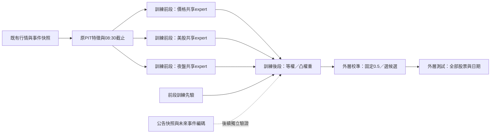

# 資訊分組、權重融合與公告資料計畫

更新：2026-11-13。使用者已選擇先使用既有資料與官方公告推進，目前沒有額外新聞歷史。第一批價格／美股／夜盤融合已實作並完成歷史比較；新聞、動態門控與波動預測另列後續交付，不混稱已上線。

## 目標與驗收

- 固定十檔唯一參與訓練、補值、標準化、權重估計、校準與選模。完整當期50檔及0050／1216／2002／2412／IX0001沿用同一模型；指數不交易。
- 每天完整預測，保留弱股、低信心、缺報與未知答案。比較平均、最低單檔、精確最弱五檔、方向基準、Brier及完整覆蓋，不能只選有效新聞日。
- 第一批只研究盤前08:30對未來1／5／20交易日收盤相對錨點收盤的方向。盤後模式可另外研究；10:00後固定秒數端點與60秒內首次變價需要獨立資料、權重及評分。
- 資訊權重是預測融合係數，不能解讀為因果影響。方向、幅度與區間各自評估；目前融合模組只提供方向機率。
- 既有歷史已多次檢視、使用當期名單與最新還原價格；外部收件時間部分重建。所有本輪結果都是開發研究，最後126日期間維持排除，未來認證仍需原始PIT證據與事前凍結的連續影子紀錄。

## 公開方法與實作查核

2026-11-13查閱以下一手資料。僅借用設計觀念，這次模組為獨立實作，沒有下載外部預測權重、匯入外部股票訓練或安裝其整套依賴。若日後採用套件，另固定版本、授權與相容環境。

| 參考 | 架構、資料與工具 | 採用方式及限制 |
|---|---|---|
| [Temporal Fusion Transformer論文](https://arxiv.org/abs/1912.09363)、[Google官方實作](https://github.com/google-research/google-research/blob/master/tft/README.md) | 區分靜態、過去觀測與已知未來輸入；變數選擇、門控、循環結構與注意力；官方範例含波動、用電、交通與零售，多期間訓練／搜尋程式 | 借用來源分組與情境門控概念。第一批用較小的共享logistic及凸融合；不採未知未來新聞作known future input，不把一般時序成果當臺股方向證據 |
| [StockNet論文](https://aclanthology.org/P18-1183/)、[作者資料庫](https://github.com/yumoxu/stocknet-dataset) | 文字與價格共同建模、循環潛在變數及變分推論；資料含2014–2016期間美股價格與tweet，保留文字created_at與OHLCV | 借用文字／價格分開編碼及時間對齊。作者美股／英文社群資料不符合固定十檔訓練範圍，不能拿來補臺股新聞或移用命中率 |
| [Qlib DoubleEnsemble官方程式](https://github.com/microsoft/qlib/blob/main/qlib/contrib/model/double_ensemble.py) | Qlib DatasetH分離train／valid；LightGBM子模型、樣本重加權、特徵抽樣及子模型融合 | 借用明確資料角色與對照消融；第一批沿用本專案快照與研究引擎，無須另裝Qlib或改資料庫。訓練樣本權重也不能刪除評分難日 |
| [FinGPT-Forecaster官方說明](https://github.com/AI4Finance-Foundation/FinGPT/blob/master/fingpt/FinGPT_Forecaster/README.md) | 數週新聞、價格與可選基本面形成下週分析；Llama-2-7b及LoRA，已發布DOW30微調模型；工具含transformers、PEFT與torch | 借用事件整理、利多／風險的結構化輸出。發布市場預測權重不符合固定十檔範圍，亦不能以今天的模型回證其訓練前的歷史PIT。第一批不需要GPU或LLM呼叫 |
| [scikit-learn stacking說明](https://scikit-learn.org/stable/modules/generated/sklearn.ensemble.StackingClassifier.html) | 基模型輸出再訓練融合器；官方明示以同一訓練預測擬合第二層的過擬合風險 | 採時間上較晚且已purge的內層權重區間，不直接使用預設StratifiedKFold；權重擬合後不重擬合基模型 |
| [CKIP官方語言模型](https://ckip.iis.sinica.edu.tw/project/language_model) | 繁體中文ALBERT／BERT／GPT2及相關中文處理資源 | 後續公司實體與文字編碼候選；先以官方公司代號建立可驗證基準。工具可辨識文字不代表能預測漲跌，模型版本與知識日期需固定 |

## 第一批已實作架構



`direction_fusion.fit_source_fusion`提供單一擬合interface，回傳模型及實際使用的訓練列；既有`fit_direction_model`在同一seam選用此adapter。呼叫端不需處理各來源補值、缺報與優化細節。

1. 每折最多756個訓練日期，前2/3用於三個共享logistic expert；價格組含既有可攜價格／固定十檔市場特徵，美股組只用`f_ext_fmp_`，夜盤組只用`f_ext_taifex_`。不含新聞、其他宏觀／法人／融資融券或產業反應組。
2. 前段答案終點必須嚴格早於後段起點，答案實際可得時間也必須嚴格早於後段最早決策；跨界列從expert訓練purge。外層仍使用原成熟標籤切分與embargo。
3. 後1/3只學融合權重，最小化按市場日期等權的Brier加固定0.01的L2等權收縮。權重非負且總和為1，先驗至少0.1；所有係數事前固定。等權候選使用相同expert資料與切分。
4. 權重後不重訓expert；每折／期間各自固定。這是按期重估的靜態權重，尚非逐股動態門控。
5. 某來源整段沒有實質輸入便不建立expert；只有age／updated旗標不算有效來源。推論時來源整列缺報，該組保留原權重並貢獻前段先驗，沒有刪日或把權重重新分配給其他來源。
6. `source_probabilities`及`contributions`可重建每筆機率；`training_details`記錄群組欄位、權重、訓練／權重日期、purge、缺來源及優化狀態。所有融合候選的明細均保存，即使未入選。

## 固定比較與重現

`--candidate-set fusion`為獨立五候選：訓練先驗、價格logistic、價格加美股／夜盤logistic、等權融合、學習融合。它不是原54候選增加兩組，不能把不同選模池差異冒稱融合的增益。預設候選集與正式模型不變。

```bash
LOKY_MAX_CPU_COUNT=1 .venv/bin/python -m twquant --root artifacts/full-membership-transfer-20261107 direction-search --config configs/research_fusion.json --candidate-set fusion --selection-policy pooled_brier --mode preopen --events artifacts/fixed-ten/sources/events.csv --overseas-window --taifex-history artifacts/taifex-night-research-20261107/futures_selected_2017_2026.csv --membership artifacts/current-membership/20261107/membership.json
```

完整離線比較使用已在本機的可信特徵快照，不需要新資料或帳號：

```bash
LOKY_MAX_CPU_COUNT=1 .venv/bin/python scripts/research_fusion.py --frame artifacts/direction-research-20261108/phase16/reference_inputs/response_lag2.parquet --config configs/research_fusion.json --membership artifacts/current-membership/20261107/membership.json --out artifacts/source-fusion-new-run --mode preopen --evidence-kind historical --information-start 2025-02-05
```

腳本在擬合前凍結六組：三控制選模、純等權、純學習權重、學習但移除美股、學習但移除夜盤、五候選選模。各組三期間、八折；原控制校準分數逐折完全相同。只有固定十檔的校準答案選模，所有外層結果完整保留，不能看完結果再自動換正式模型。

輸出含不可覆寫的`protocol.json`、各組逐筆預測與報告、`comparison.json`；程序／runner／輸入檔雜湊在結束時重新核對。另以完整日期乘股票網格獨立重算平均、最低單檔、最弱五檔及覆蓋；配對差異按共同市場日期區塊重抽。可選資訊就緒起點僅作原有次要診斷，不能替代完整歷史。

2026-11-13實際比較已完成：學習權重相對等權的方向平均有所改善，但日期區塊區間未排除零；加入融合候選沒有穩定勝過同一控制組，較長期間亦有退步。六組全部完整75%門檻未達。實際分數、權重、資料與程式快照只存本機`artifacts/source-fusion-20261113-v1/`，不發布提供者資料或替換正式模型。

## 資料盤點與取得順序

| 資料 | 現況 | 下一步與通過條件 |
|---|---|---|
| 臺股日線／美股／夜盤 | 已有可重現長期矩陣，可立即作上述比較 | 持續核對還原版本、session／契約、DST、可用時間與修訂；現取得價格不升格為當年實際收件 |
| 官方重大訊息 | 既有TWSE正規化、不可覆寫快照及文件版本匯出已可用；本輪另完成一次無Key唯讀擷取 | 先累積連續收件日與完整來源覆蓋，不把缺少快照的日子視為沒有公告；不假造歷史公告 |
| 媒體新聞 | 使用者目前沒有歷史庫；既有News API／GDELT快照不能替代多年可用文本 | 先做官方公告版本。若後續評估付費媒體，先取得歷史範圍、繁中涵蓋、標題／內文權利、發布與修訂時間及匯出格式，再提出具體選項 |
| 財報／營收意外 | 有來源與部分數值，缺完整科目、單位與歷史共識版本 | 先做確定可得的事件類別、金額、同比／環比；沒有當時共識便不能假造surprise |
| 盤中委託／成交 | 已有離線因果矩陣與合成研究；沒有足量真實逐事件驗證 | 若另做60秒首次變價，需可排序完整事件、exchange／receipt時鐘、缺報與重連證據；日線或分K不能證明首次事件 |

來源查核：[TWSE官方OpenAPI](https://openapi.twse.com.tw/)為本機既有重大訊息入口；[TAIFEX官方下載](https://www.taifex.com.tw/cht/3/dlFutDailyMarketView)明示夜盤日期是交易量歸屬日，不能直接當實際日曆日。

[News API端點](https://newsapi.org/docs/endpoints/everything)適合文章發現；[官方方案說明](https://newsapi.org/pricing)目前列Developer為24小時延遲、最多一個月搜尋，且不提供完整文章內容。實際帳號方案需另外核對，不用「已有Key」推定完整歷史或即時權限。[GDELT官方資料頁](https://gdeltproject.org/data.html)說明GKG為15分鐘更新的中繼資料，不能把單批資料視為完整繁中內文庫。

[Fugle歷史行情文件](https://developer.fugle.tw/docs/data/http-api/historical/candles/)區分日線與分鐘歷史；分鐘K線仍無法重建所有逐事件先後。這些限制決定應先完成日線融合與公告收件，而不是先購買GPU或大型模型。

## 後續交付與啟動條件

| 階段 | 交付 | 啟動條件與驗收 |
|---|---|---|
| A：本輪已完成 | 三資訊組、等權／學習權重、兩個來源消融、相同控制、完整歷史評分、官方公告單次收件 | Python／Node／秘密稽核、外部隔離、成熟邊界、缺報回退與精確重播；未達標照實保存 |
| B：官方公告資料集 | 公司代號、首次收件、發布、版本、內容雜湊、事件類別、數值與去重群集；人工標註小型固定驗證集 | 先檢查連續來源覆蓋。不能靠兩次快照訓練新聞模型；實體／事件標註驗收後才加入公告expert，無事件和未觀測須分開 |
| C：共享動態權重 | 僅用決策前的資訊年齡、缺報、流動性／波動與已知曝險作小型門控，與靜態版本比較 | 保持expert／門控時序隔離與正則化，限制搜尋量；外部股票不能提供門控訓練或縮放統計，所有日子持續輸出 |
| D：幅度與區間 | 另建報酬／絕對變動與區間預測頭 | 不把方向機率或新聞情緒強度當波動量；另驗證誤差、覆蓋及成本後策略 |
| E：獨立未來驗證 | 凍結配方、每日紙上發報及成熟結算 | 資料PIT、至少60個真實交易日／500筆及時成熟h1紀錄及既有門檻；啟用排程前另有主機、告警、互斥與授權 |

目前不需要使用者提供金鑰、購買訂閱或更換硬體。接下來能自主處理的是既有離線研究、公告格式／版本／覆蓋檢查與手動收件流程。連續未來證據需要真實時間；若要每天無人值守，再具體確認主機及排程，不把範本說成已啟用。

## 公告手動收件

`configs/announcement_collection.json`只含一個官方唯讀工作，沒有價格、券商或付費來源。依需要手動執行，不安裝排程：

```bash
.venv/bin/python -m twquant --root artifacts/source-fusion-announcements sources sync --plan configs/announcement_collection.json
.venv/bin/python -m twquant --root artifacts/source-fusion-announcements sources export-documents
```

保留`published_at`、`available_at`、`source_snapshot_id`及`content_sha256`。本輪本機盤點與缺口在`artifacts/source-fusion-announcements-20261113/readiness.json`；公開Git只保存程式、設定與方法，不包含公告原文、提供者行情、模型或私人報告。
