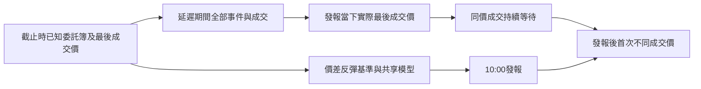

# 每日完整成交價首次變動研究

使用者於2026-11-13接受包含買賣價差反彈的成交價目標。每天10:00對全部50檔發報，預測發報後60秒內第一次不同成交價的方向；同價成交繼續等待，逾時仍計錯。中間價研究與日收盤研究各自驗收。

固定2330、2454、2317、2308、3711、1303、2383、2881、2891、3037是唯一訓練、補值、校準及選模來源。0050、1216、2002、2412沿用同一模型查詢。IX0001仍取得共享先驗查詢，但指數沒有成交價，答案保留未知，不虛構指數交易。

## 機制與來源

最後成交在賣價、報價尚未變動時，下一筆同側成交仍是同價；首次換到買價成交便向下。最後成交在買價時反向亦然。這使成交價方向可能包含機械性反彈，即使中間價沒有可預測趨勢。

[Roll1984原文](https://onlinelibrary.wiley.com/doi/full/10.1111/j.1540-6261.1984.tb03897.x)在固定價差、無新資訊及兩側隨機成交的模型中推導此機制。[Niederhoffer／Osborne1966原文摘要](https://www.tandfonline.com/doi/abs/10.1080/01621459.1966.10482183)另報告特定下跌後反向與續跌的相對機率；其條件事件、舊NYSE制度及樣本不能直接換成本系統每日全部臺灣股票的75%。本輪借用價格形成機制，沒有移植外國股票資料、逐股權重或論文成績。

研究必須同時揭露固定價差反彈基準，才能判斷學習模型是否增加訊息。命中此成交價標籤，也不會自動產生可成交的價差內獲利。

## 時間、執行與標籤

沿用[離散隊列研究](QUEUE_FIRST_CHANGE.md)的五檔整數隊列、100個過去事件、65%市場移除／15%撤單／20%新增、單筆1至4單位，以及與隊列亂數獨立的Poisson事件時鐘。中性情境兩側市場訂單各半；每事件壓力翻轉率、整數數量、到達率與深度仍是未校準的人工規則。

市場事件在**隊列重設前**的最佳買價或賣價成交一次；超過最佳隊列的剩餘量取消，不穿透更深價格。這個簡化不代表真實掃單或供應商成交訊息聚合方式。最佳價差固定一跳，中間價耗盡後移動一跳；程式用半跳價格記錄成交。暖機初始成交明示為買價或賣價，之後每筆市場事件更新最後成交價。

[證交所交易規則](https://www.twse.com.tw/zh/about/company/guide.html)允許同一委託依對手方價格逐價成交；本輪取消剩餘量的規則只涵蓋最佳價受限的激進單假設，未包含全部市價掃單。[ABIDES原始撮合程式](https://github.com/abides-sim/abides/blob/master/util/OrderBook.py)可參考逐價部分成交及保留剩餘量的機制，但其`LAST_TRADE`紀錄使用一次委託的平均成交價，不能直接當作本目標的逐筆價格；應另保留每次執行價格與順序。這是後續需處理的模型差異，不能因本輪高分便省略。



輸入截止為`10:00−latency`。發報前的成交、變價與隊列重設都繼續處理，答案錨點更新為發報當下的實際最後成交價。例如發報前先從賣價跌到買價，發報後才成交回賣價，答案是向上，不能相對較舊賣價判成平盤。

只有成交使最後成交價改變才算事件；只有委託簿變動或同價成交都不算。期限後的下一個事件才能證明逾時；2048事件預算先用完則保留未知，主要訓練／校準若未知會停止研究。分類介面沿用`actual_return`欄位承載一單位正負號除以抽象錨點的方向碼；多跳幅度與可交易報酬不由此欄位估計。

## 候選與事先固定的比較

四個候選均使用固定十檔成熟標籤與同一組共享規則：

|候選|輸入與規則|
|---|---|
|先驗|固定十檔已知方向比例；缺報亦用此回退|
|價差反彈|最後成交價低於當下中間價則向上，反之向下；不按股票分開擬合|
|共享logistic|當下不平衡、相對深度、過去事件摘要及最後成交價相對中間價的位置|
|共享hist|使用相同可觀測特徵的共享樹模型|

只有明確允許的特徵可進入模型，隱藏壓力、發報時實際錨點、事件率宣告及未來診斷都不當作特徵。最後成交位置為`2×(last_trade−mid)/spread`，本人工過程的價差固定一跳。事件率是物理過程參數，歷史窗口單位仍是事件，不能當作秒。外部股票只提供自己的可觀測查詢，不能改訓練或校準。

`configs/trade_first_change.json`在第一組研究擬合前固定600訓練、200校準、2000測試日期、三種子及以下十二情境，共36組與144個候選稽核：

|情境|預先固定條件|
|---|---|
|中性零延遲|每秒100個隊列事件|
|100微秒／1／5／20／100毫秒|輸入截止至發報的完整未觀測演化|
|慢活動|每秒1事件、5毫秒延遲|
|逾時壓力|每秒0.01事件、5毫秒延遲|
|共同缺報|25%日期全部輸入缺報，仍每天回答|
|外部較快、5毫秒|只有1216、2303、2327、2345、2357改為每秒1000事件|
|外部較快、100微秒|相同外部干預，縮短宣告延遲|
|混合流動性|中等方向壓力，係數0／1.5各半；係數不供模型使用|

全部日期為明示的合成平日；每組只依固定十檔校準期的最低單檔、平均及固定候選順序選模。所有候選保留完整測試結果，額外列出價差反彈及同校準資料選出的簡單控制；不按測試答案挑選股票、模型或種子。

```bash
LOKY_MAX_CPU_COUNT=1 .venv/bin/python -m twquant direction-trade-first-study --config configs/trade_first_change.json --membership artifacts/current-membership/20261107/membership.json --out artifacts/trade-first-new-run
```

## 結果

36組、144個候選稽核全部完成；每組保留50檔各2000測試日期，以及三個額外轉移查詢。表中為三種子範圍，全部弱股與失敗情境保留：

|情境|所選模型最弱五檔|所選模型最低單檔|反彈基準最弱五檔|
|---|---:|---:|---:|
|零延遲|80.27%～81.25%|79.85%～80.85%|81.12%～81.25%|
|100微秒|80.52%～81.01%|80.20%～80.60%|80.84%～81.01%|
|1毫秒|78.68%～78.98%|77.95%～78.75%|78.62%～78.98%|
|5毫秒|70.61%～71.16%|69.90%～70.60%|70.62%～71.02%|
|20毫秒|57.34%～59.15%|57.00%～58.65%|53.84%～54.83%|
|100毫秒|48.74%～49.29%|47.60%～48.65%|46.86%～47.60%|
|每秒1事件|80.77%～81.20%|80.35%～80.60%|81.01%～81.15%|
|每秒0.01事件|15.64%～16.47%|15.25%～16.35%|15.64%～16.47%|
|25%共同缺報|64.38%～66.25%|64.05%～65.95%|64.39%～65.70%|
|外部較快、5毫秒|49.62%～50.43%|47.30%～49.40%|48.80%～49.62%|
|外部較快、100微秒|79.70%～80.12%|77.95%～78.90%|79.70%～80.12%|
|混合流動性|70.60%～71.77%|69.35%～71.40%|70.20%～70.72%|

15／36組通過完整樣本門檻；同時要求最低單檔75%與逐股方向基準優勢。已找到可重現超過75%的**條件式成交價模擬**，主要優勢來自已揭露的價差反彈。學習模型在低延遲時沒有穩定勝過簡單基準，較長延遲下的部分改善仍不足以達標。

以50檔乘36組作單側Clopper–Pearson多重比較校正後，10組的最低單檔條件抽樣下界達75%。100微秒情境下界為76.419%～76.844%；外部五檔較快時為74.038%～75.041%，三種子僅一組下界過關。這些界限只描述宣告人工過程中的有限樣本誤差，不校正市場規則或參數偏差。每秒0.01事件情境保留約82.06%～82.40%的逾時，沒有只對發生變價的日期報高分。

本過程的兩個關鍵時間量為`event_rate×latency`及`event_rate×deadline`。例如每秒1000事件、100微秒的五個外部股票，與每秒100事件、1毫秒的相同股票具有相同發報前事件序列；只要兩者均未逾時，其首次變動方向及錨點相同，發報後等待時間則相差十倍。這說明設計需要同時評估行情活動速度與新鮮度，不能只列推論執行時間。

數值協定、全部候選輸出、來源快照與獨立核對保存於本地`artifacts/trade-first-20261113-v1`。核對重建全部固定十檔校準與四候選機率、完整每日分母、反彈基準及外部干預隔離，並以獨立純量程式核對重設前最佳價執行、錨點、事件時鐘與逾時。舊中間價面板、四候選機率及稽核數字保持一致。

凍結數值完成後，另將不支援成交價的指數診斷錨點由繼承的0改為未知；其答案在原研究中已是未知。原協定與輸出保留，附錄核對只有此診斷分支改動、重新生成全部53標的2000日期，以及四候選重新擬合後的機率與稽核完全相同。

## 設計落地條件

如果優勢只存在於很短的未觀測期間，架構需要在行情接收端持續更新特徵，讓10:00發報只讀取已準備的共享預測與原始收件證據；延後到網頁查詢或大型文字模型回應時才計算會改變驗收時間。研究用Python計算速度不能當作真實行情至發報的延遲量測。

本地另以固定十檔6000筆訓練資料擬合反彈候選，對50檔單日輸入暖機後計時200次：現有DataFrame推論介面的中位數約3.440毫秒、99百分位約3.998毫秒，尚未包含收件、特徵維護、時鐘誤差與持久化。這個實作不能直接滿足宣告的100微秒條件；後續需要獨立的精簡推論路徑及端到端預算，仍不能把局部加速當作行情延遲已通過。

[證交所主機共置Q&A](https://www.twse.com.tw/en/products/colo/qa.html)說明合格證券商與簽訂直接行情契約的資訊商可使用同地點連線，並列出NTP、目前未提供PTP等條件。該文件沒有承諾本研究指定的100微秒端到端新鮮度；服務存在也不代表本專案已有使用資格、線路或時鐘精度。此處只評估架構條件，沒有申請、購買或啟用服務。

真實輸入需完整成交序列、同期可用買賣報價、交換所／收件時鐘、重連與缺口紀錄，並記錄實際發報時間。官方成交欄位及其完整性缺口見[行情契約核對](QUEUE_FIRST_CHANGE.md#真實行情接入的缺口)。來源缺口保留未知，不能用較晚快照補成當時已知。資料與固定時間分布還需支持單筆量、掃單、跳動單位與外部轉移假設；合成高分本身不證明現有供應商與本機架構的市場75%。

[證交所制度說明](https://www.twse.com.tw/zh/products/system/trading.html?hl=zh-TW)同時列出即時交易資訊與5秒行情快照，接入時需明確辨認來源頻率；較慢快照不能還原其間第一次不同成交價。[富邦WebSocket文件](https://www.fbs.com.tw/TradeAPI/docs/market-data/websocket-api/getting-started/)雖提供Speed／Normal模式，該頁沒有本研究所需的數值延遲保證。單純切換模式不能視為達到微秒級條件。
